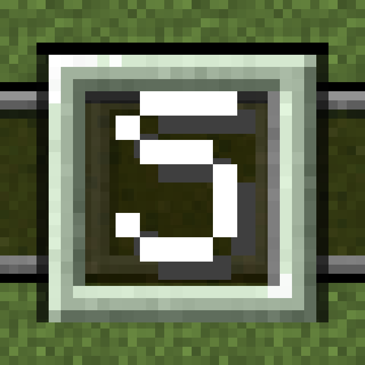

# SmoothHotbar (Fabric 1.20.1-26.3)

Client-side Fabric mod that makes the hotbar move smoothly: a sliding selection frame with configurable easing, a portal between slots 1 and 9, smooth item cooldowns and an optional flat design.



## Supported versions

| Minecraft | Mod version | Java |
| --- | --- | --- |
| 1.20.1 | 1.0 | 17+ |
| 1.21.1 | 1.0 | 21+ |
| 1.21.2-1.21.4 | 1.0 | 21+ |
| 1.21.5 | 1.0 | 21+ |
| 1.21.6-1.21.8 | 1.0 | 21+ |
| 1.21.9-1.21.11 | 1.0 | 21+ |
| 26.1-26.1.2 | 1.0 | 25+ |
| 26.2-26.2.2 | 1.0 | 25+ |
| 26.3 | 1.0 | 25+ |

All ports live on `main`. The Gradle build keeps shared logic in common source sets and adds only the API-specific classes required by each Minecraft version.

## Features

- Selection frame slides between slots instead of jumping.
- Six easing curves: linear, ease out, ease in-out, exponential, overshoot and elastic.
- Portal between slots 1 and 9: the frame leaves through one edge and enters from the other instead of flying across the whole hotbar.
- Smooth item cooldowns: ender pearls, shields and other cooldowns shrink every frame instead of in pixel steps.
- Two designs:
  - **Vanilla** - uses the game's hotbar textures, so resource packs keep working.
  - **Custom** - flat translucent panel with adjustable corner radius, opacity, background and accent colors.
- Optional growth of the selected item.
- Adjustable scale and distance from the bottom edge. Hearts, hunger, armor and experience move with the hotbar.
- Optional auto-hide: the hotbar slides away while you are idle and comes back when you switch slots, pick up or use items, take damage or open a screen.
- English and Russian translations.
- Mod Menu and Cloth Config integration.

## Installation

1. Install Fabric Loader and Fabric API for your Minecraft version.
2. Put the matching SmoothHotbar JAR in the `mods` folder.
3. Optionally install Mod Menu and Cloth Config for the in-game configuration screen.

## Configuration

Open **Mods -> SmoothHotbar -> Configure**. Settings are saved to `config/smoothhotbar.json`, which can also be edited by hand.

## Building

The complete build requires JDK 25 because the `26.x` targets use Java 25 bytecode. Minecraft 1.20.1 is compiled with `--release 17`, while the 1.21.x targets use `--release 21`.

Build every supported version:

```powershell
.\gradlew.bat clean buildAll
```

On Linux or macOS:

```bash
./gradlew clean buildAll
```

The nine release JARs are collected in `build/libs/`. Range builds include the full supported interval in the filename, for example `smoothhotbar-1.21.2-1.21.4-1.0.jar`.

Build only one target when developing:

```powershell
.\gradlew.bat '-PonlyTarget=1.21.11' ':1.21.11:build'
.\gradlew.bat '-PonlyTarget=26.3' ':26.3:build'
```

Per-version build output is also available under `versions/<minecraft-version>/build/libs/`.

## Project layout

- `src/common` - animation state, renderer and config shared by every target.
- `src/main/resources` - assets, translations and the mixin config shared by every target.
- `src/legacy` - shared Yarn-based code for Minecraft `1.20.1-1.21.11`.
- `src/legacy-matrix3d` and `src/legacy-matrix2d` - GUI matrix stack before and after `1.21.6`.
- `src/legacy-item-in-slot` and `src/legacy-stack-overlay` - item overlay and cooldown APIs before and after `1.21.2`.
- `src/legacy-slot-field` and `src/legacy-slot-getter` - selected slot access before and after `1.21.5`.
- `src/legacy-sprites-plain`, `src/legacy-sprites-layer`, `src/legacy-sprites-pipeline` - GUI sprite APIs of `1.21.1`, `1.21.2-1.21.5` and `1.21.6+`.
- `src/legacy-main-hud-level` and `src/legacy-main-hud` - HUD mixins for `1.21.1-1.21.5` and `1.21.6-1.21.11`.
- `src/modern` - shared unobfuscated API code for Minecraft `26.x`.
- `src/modern-gui` and `src/modern-hud` - HUD mixins for `26.1` and `26.2+`.
- `versions/<version>` - metadata and Java classes for each exact or range build target.
- `build.gradle` - the single version/dependency matrix and all build configuration.

## Credits

Original author and idea: [mel1x](https://www.curseforge.com/members/mel1x/projects)

## License

SmoothHotbar is available under the [MIT License](LICENSE).
