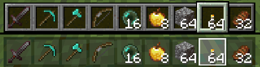

# SmoothHotbar

Client-side Fabric mod that makes the hotbar move smoothly.



## Features

- Sliding selection frame with six easing curves.
- Portal between slots 1 and 9 instead of flying across the hotbar.
- Smooth item cooldowns.
- Vanilla design that keeps resource pack textures, or a custom flat design.
- Adjustable scale, offset from the bottom and optional auto-hide.

## Supported versions

Minecraft 1.20.1, 1.21.1-1.21.11 and 26.1-26.3. Pick the JAR matching your version.

## Installation

1. Install Fabric Loader and Fabric API.
2. Put the SmoothHotbar JAR in the `mods` folder.
3. Optionally install Mod Menu and Cloth Config for the settings screen.

## Building

Requires JDK 25. Release JARs end up in `build/libs/`.

```bash
./gradlew buildAll
```

## License

[MIT](LICENSE)
